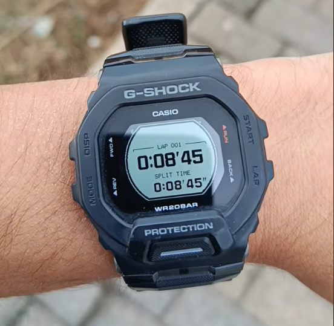
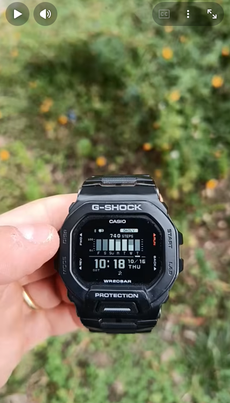
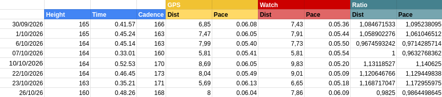

In the last two years, I introduced a new sport in my routine: running; as far as I started doing it, I've got
the need of in some way measure my training performances. Since my philosophy is based on a mixture of 
privacy, KISS and low technology principles, I decided to buy a Casio GShock GBD-200 watch, which is just a Casio
watch with some useful features:

- ~2 year battery (as always in casio watches)
- step counter
- running computer with realtime pace, distance and time
- bluetooth for syncing time and running activities

I won't call it a smart watch, since it is stupid enough. Using the official Casio app you can sync your workouts 
with your phone and then submit to Strava so everyone knows you're the perfect runner; or maybe you can write your
workouts in a sheet, it's your choice (guess mine).

The running computer feature is achieved using a 3-axis accelerometer, that is able to detect the cadence and then 
calculate the distance and so the pace.

Unfortunately (and obviously), the cadence / distance value is not precise: the cadence is calculated counting your wrist
movements (which should be synchronized more or less with your arms), but the distance calculation depends
on your stride length, which cannot be set by you. It only allows to set your height, approximating the 
stride length with this value.

Since I wanted to see more precise values, for some times I recorded the running sessions also with my phone GPS,
and then I created a table where I compared data from watch and gps, along with the detected cadence and the height set.

<!--  -->

   Date       | Height | Time  | Cadence | GPS Dist | GPS Pace | Watch Dist | Watch Pace | Dist Ratio | Pace Ratio |
 |------------|--------|-------|---------|----------|----------|------------|------------|------------|------------|
 | 30/09/2026 | 165    | 41:57 | 166     | 6.85     | 6:08     | 7.43       | 5:36       | 1.0847     | 1.0952     |
 | 01/10/2026 | 165    | 45:24 | 163     | 7.47     | 6:05     | 7.91       | 5:44       | 1.0589     | 1.0610     |
 | 06/10/2026 | 164    | 45:14 | 163     | 7.99     | 5:40     | 7.73       | 5:50       | 0.9675     | 0.9714     |
 | 07/10/2026 | 164    | 33:01 | 160     | 5.81     | 5:41     | 5.81       | 5:54       | 1.0000     | 0.9633     |
 | 10/10/2026 | 164    | 52:53 | 170     | 8.69     | 6:05     | 9.83       | 5:20       | 1.1312     | 1.1406     |
 | 22/10/2026 | 164    | 46:45 | 173     | 8.04     | 5:49     | 9.01       | 5:09       | 1.1206     | 1.1294     |
 | 23/10/2026 | 163    | 35:21 | 171     | 5.69     | 6:13     | 6.65       | 5:18       | 1.1687     | 1.1730     |
 | 26/10/2026 | 160    | 48:26 | 168     | 8.00     | 6:04     | 7.86       | 6:09       | 0.9825     | 0.9864     |

At every session I adjusted the height value, and then I compared the difference between gps and watch values; after 
some adjustment I finally got a decent value set as my height (160) in order to get reasonable values (~2% error rate).

So, is the GBD200 a good watch for running? Probably not. Does a good watch make you a good runner? Probably not even 
this. What I know is that it's the perfect watch for me and for my minimalism need. 

Enjoy your runs!

